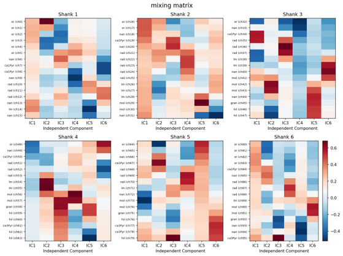
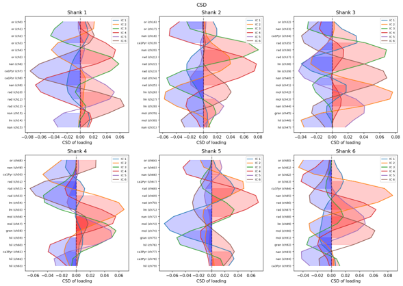
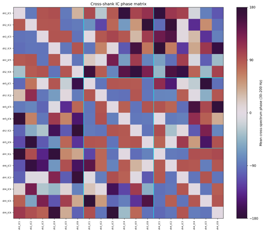
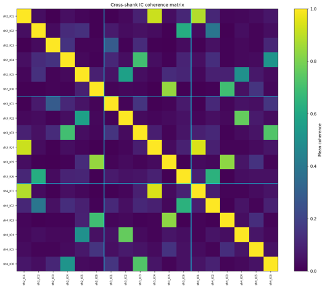
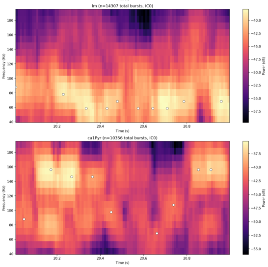
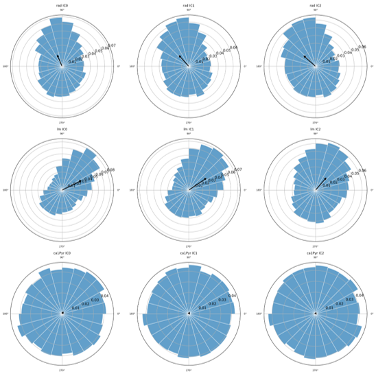
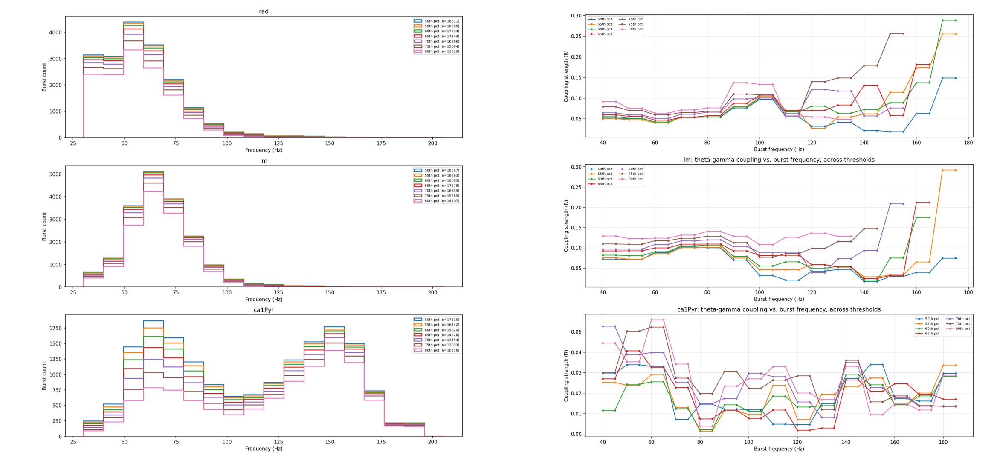

# Gamma-theta coupling in hippocampal CA1

Analysis pipeline for a 96-channel hippocampal LFP recording, looking at
whether gamma bursts from different anatomical input layers of CA1 occur
at different phases of the theta cycle. Built for the WP7 practicum
(Computational Neuroscience MSc, LMU Munich), following the approach in
Schomburg et al. (2014) and Sirota et al. (2008).

## Background

CA1 pyramidal cells get gamma-band input from two separate afferent
pathways plus local circuitry:

- **stratum radiatum (`rad`)**  CA3 input via Schaffer collaterals, slow
  gamma (~30-50 Hz)
- **stratum lacunosum-moleculare (`lm`)** entorhinal cortex layer III
  input, medium gamma (~50-90 Hz)
- **pyramidal layer (`ca1Pyr`)** local, perisomatic fast gamma
  (~90-150 Hz), generated by fast-spiking interneurons rather than driven
  by an afferent input

Schomburg et al. 2014 argue that CA3 and entorhinal input are kept apart
in time by arriving at different phases of the theta cycle, which would
let CA1 read them out separately instead of them interfering with each
other. This project tries to reproduce that phase separation from the raw
LFP, source-separating the three layers with ICA rather than reading them
off single channels.

## Pipeline

1. **Load data** — LFP, channel map, event file; keep only the "run"
   epochs (theta is strongest while the animal is moving).
2. **AR whitening** — flattens the 1/f LFP spectrum per channel before
   ICA. Not applied before theta phase extraction later, since whitening
   would remove the rhythmic structure that step needs.
3. **PCA + ICA per shank** — gamma-band ICA run separately on each
   16-channel shank (not on all 96 channels at once), because CSD needs
   physically adjacent, evenly spaced channels, which only holds within
   one shank.
4. **CSD on the ICA loadings** — second spatial derivative of each
   component's channel-loading profile, used to read off which
   anatomical layer it comes from (sink = input site, except `ca1Pyr`,
   which shows as a source because of perisomatic inhibition).
6. **Cross-shank matching** — coherence (not correlation, since the same
   source can show a small lag across shanks) to match the "same"
   component across shanks, then cross-spectrum phase to catch and
   correct ICA's sign ambiguity (a component and its sign-flipped mirror
   image are both valid ICA solutions).
7. **Burst detection** — 2D local maxima on the gamma spectrogram
   (time x frequency), with light smoothing and a minimum 50 ms
   separation between detected bursts, rather than a simple 1D
   Hilbert-envelope threshold.
8. **Theta phase** — Hilbert transform (6-12 Hz bandpass) on the raw,
   non-whitened LFP from a CA1 pyramidal channel.
9. **Circular statistics** — resultant length (R), pairwise phase
   consistency (PPC), Rayleigh test, and preferred phase, for each
   layer's gamma bursts relative to theta phase; repeated split by
   slow/medium/fast gamma sub-band.
10. **Robustness check** — sweeps the burst-detection threshold and a
    sliding gamma frequency window to check whether the main result holds
    up across parameter choices rather than being specific to one
    threshold.

## Main result

- `rad` and `lm` prefer theta phases roughly 90-100 degrees apart, and this separation holds up across the threshold/frequency robustness sweep, consistent with Schomburg et al. 2014
- `ca1Pyr` (local fast gamma) shows weaker, less consistent phase locking, which fits it being locally generated rather than driven by a phase-locked afferent input



*Per-shank ICA mixing matrix (channel loadings) feeding into the CSD step.*


*CSD profiles used to assign each component to rad / lm / ca1Pyr.*


*Cross-shank correlation between components — the motivation for using
coherence instead (see pipeline step 6).*


*Cross-shank coherence matrix used to match the same component across
shanks.*


*Spectrogram with detected gamma bursts overlaid, one component.*


*Circular histograms of theta phase at burst onset, by layer — the main
result.*


*R and preferred phase swept across detection threshold and gamma
frequency, checking the main result isn't an artifact of one threshold.*

## Repo structure

```
gamma-theta-coupling/
├── README.md
├── environment.yml
├── notebooks/
│   └── 01_gamma_theta_pipeline.ipynb   analysis notebook, run top to bottom
├── figures/                            exported result figures
└── data/                               not included, see below
```

## Data

The raw LFP recording is not included in this repo. To rerun the notebook, place the subject's LFP file,
`channels.tsv` and `events.tsv` in `data/` and set `sub`/`ses` at the top of the notebook.

## Setup

The notebook imports `wp7_helpers`, the course-provided module for the WP7
spectral-analysis exercises (multitaper spectra, coherence, cross-spectrum,
circular statistics). It isn't mine, so it isn't included here,  drop your
own copy of `wp7_helpers.py` into `notebooks/` (next to the notebook)
before running.

```
conda env create -f environment.yml
conda activate gamma-theta
jupyter notebook notebooks/01_gamma_theta_pipeline.ipynb
```

## References

- Schomburg EW, Fernández-Ruiz A, Mizuseki K, Berényi A, Anastassiou CA,
  Koch C, Buzsáki G (2014). Theta phase segregation of input-specific
  gamma patterns in entorhinal-hippocampal networks. *Neuron*, 84(2),
  470-485.
- Sirota A, Montgomery S, Fujisawa S, Isomura Y, Zugaro M, Buzsáki G
  (2008). Entrainment of neocortical neurons and gamma oscillations by
  the hippocampal theta rhythm. *Neuron*, 60(4).
